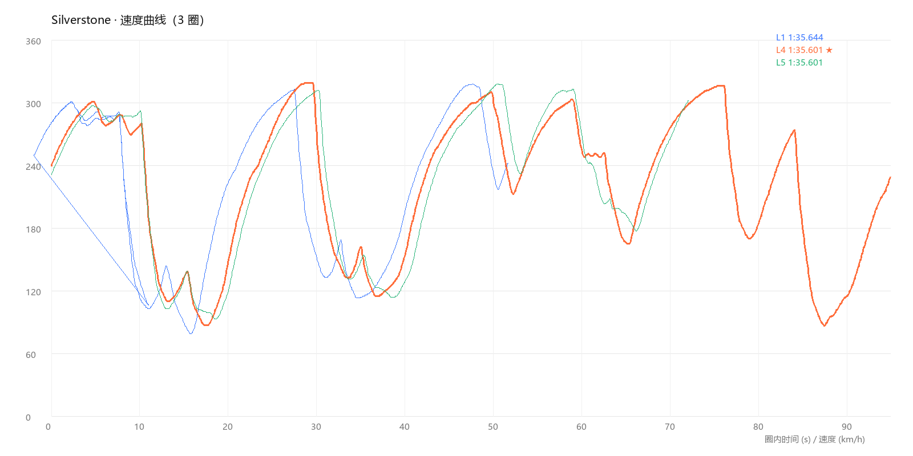

# dsh-sim-telemetry

> **给 DeepSeek Harness 的赛车遥测插件：跑完几圈，它告诉你「这一圈到底差在哪」。**

不用装第三方遥测软件，不用上传数据 —— 采集和分析全在你自己的电脑上跑，
DSH 里的 AI 负责把数据读成"能听懂的话"。



---

## 它是什么

跑赛车的时候，你知道自己慢，但往往说不清**慢在哪** —— 是 Copse 弯不敢带油？是刹车点早了？
还是出弯给油太晚？游戏只给你一个圈速，不给你答案。

这个插件把游戏的 UDP 遥测抓下来，切圈、算分段、找弯道，然后输出：

- **圈速与分段**：这一圈几分几秒、哪一段慢
- **弯道拆解**：每个弯的 apex 速度、入弯速度、出弯速度
- **驾驶行为**：全油门占比、刹车占比、滑行占比（滑行多 = 松油太早）
- **该改什么**：直接告诉你「这个弯敢带油」「出弯给油再早一点」

分析全部在本地 Python 里完成，模型只读结论那几行 —— **省 token 也省心**。

---

## 功能

### 采集
- F1 25 UDP 遥测（端口默认 `20777`，**可在设置里改**，和游戏设置保持一致）
- 玩家 + 全部 22 辆车的数据
- 原始数据落盘，可反复分析

### 分析
- 自动切圈、圈速、圈速有效性
- 按速度曲线识别弯道（apex / 入弯 / 出弯）
- 20 段速度曲线对比（哪一段掉速最多）
- 全油门 / 刹车 / 滑行占比
- 与最快圈逐弯对比

### 产出
- **文字摘要**：几行结论，直接看
- **CSV 表格**：每圈汇总，可自己拿去画图
- **完整明细 md**：每圈每段的详细数据
- **速度曲线图 / 油门刹车图**：PNG，直观对比

### 自动化
- 「跑到第 N 圈自动出报告」：跑满自动停、自动生成
- 设置面板里开关、调时长、调圈数、**改 UDP 端口**
- 四个工具：`telemetry_start` / `telemetry_stop` / `telemetry_summary` / `telemetry_plot`

---

## 安装

在 DSH 的「设置 → 插件」里，输入下面任意一种：

| 方式 | 填什么 |
|---|---|
| GitHub（推荐） | `https://github.com/jingjie43/dsh-sim-telemetry` |
| npm | `dsh-sim-telemetry`（需先发布到 npm） |
| 本地 | 插件目录绝对路径 |

装完**重启 DSH**，设置左侧会出现「赛车遥测」。

### 环境依赖

- **Python 3.10+**（3.11 / 3.12 / 3.13 都行）
- `Pillow`（只有画图需要，不画图可以不装）

**第一次用不用自己折腾环境**：打开「设置 → 赛车遥测」，面板会自动检测 Python ——

- 检测到 3.10+：直接显示版本，能用
- 没检测到：会出现「**一键安装 Python 3.12**」按钮（先试 winget，不行自动下官方安装包静默装）
- 缺 Pillow：会出现「安装 Pillow」按钮
- 想自己指定：面板里能填 Python 路径（留空就自动探测：指定路径 → `py` 启动器 → 常见安装目录 → PATH）

---

## 使用方法

### 游戏里先开遥测
F1 25 → 设置 → 遥测 → **UDP 开启**，端口 `20777`（游戏里改成别的端口也行，插件设置里同步改即可）

### 三步搞定
1. **开始记录**：DSH 设置 →「赛车遥测」→ 打开开关 → 点「开始记录」
   （或者跟我说一句「开始记录」）
2. **跑你的圈**：想自动收工就设「跑到第几圈自动出报告」
3. **看报告**：跑完自动生成，或在对话里说「出摘要」「画个图」

### 数据在哪

```
~/.dsh/sim-telemetry/
├── allcars_*.jsonl     # 原始遥测
├── laps_*.csv          # 每圈汇总表
├── summary_full_*.md   # 完整明细
├── plots/              # 速度曲线图 / 油门刹车图
└── settings.json       # 面板设置
```

---

## 未来展望

目标不是"F1 专用"，而是**通用赛车遥测助手**。

| 优先级 | 游戏 | 状态 |
|---|---|---|
| 1 | F1 25 | 已支持（持续打磨） |
| 2 | 神力科莎竞速（ACC） | 计划中 |
| 3 | 神力科莎（AC） | 计划中 |
| 4 | 其他大众赛车游戏 | 视需求 |

架构上已经把「采集」和「分析」拆开：每个游戏一个适配器（`lib/py/collect_<game>.py`），
分析管线（切圈 / 分段 / 弯道 / 报告）全部共用 —— 加新游戏只是加一个文件。

远期想做：
- 与 AI 车手遥测对比（"AI 在这个弯比你快多少"）
- 圈速进步曲线（跨场次记录）
- 赛道分段可视化（速度热图）
- 更多游戏适配器

---

## 已知限制

- 同时只能跑一个采集任务；同一时间只能监听一个端口
- **目前只支持 F1 25 的「2025 赛制」**（UDP 包格式 2025）；其他赛季/经典模式、F2 等尚未适配
- 弯道是按速度曲线识别的，**不知道真实弯名**，编号按出现顺序
- 遥测不含位置数据，逐弯对比是按速度谷对齐的近似

---

## License

MIT
